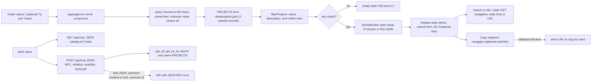

# 01 — Business process (As-Is / To-Be)

portfolio-projects-showcase-web คือเว็บ Next.js ที่โชว์ตัวอย่างโปรเจกต์ 2 รายการ (placeholder จาก `data/projects.json`) ให้ผู้เยี่ยมชมค้นหา สลับมุมมอง All / Featured และเปิดดูรายละเอียด พร้อม endpoint `/api/mcp` แบบอ่านอย่างเดียวที่ให้ข้อมูลชุดเดียวกัน ไม่มีการแก้ไขหรือเก็บข้อมูลผู้ใช้

Last reviewed: 2026-11-28 · commit `354e5ef`

## As-Is (จากโค้ดวันนี้)

Sources: `app/page.tsx`, `components/showcase-view.tsx`, `components/copy-endpoint.tsx`, `lib/projects.ts`, `data/projects.json`, `app/api/mcp/route.ts`, `lib/sentry.ts`, `PRODUCT.md`

ข้อเท็จจริงจากโค้ด:

- สองระเบียนเป็นข้อมูลตัวอย่าง ไม่ใช่รายการโปรเจกต์จริง (ของจริงอยู่ที่ portfolio-site-web); ไม่มี storage ไม่มีการแก้ไข
- `POST /api/mcp` ตอบ status 400 กับทุก error รวมถึง method หรือ tool ที่ไม่รู้จัก และไม่มีการจัดการ notification แยก
- Sentry ส่งเฉพาะ error เมื่อมี `NEXT_PUBLIC_SENTRY_DSN` ตั้งบน Vercel จริงหรือไม่ [ต้องยืนยัน]
- การ deploy: `PRODUCT.md` (2026-10-23) ระบุว่า Git link ของ Vercel ยังชี้ repo เก่า ทำให้ push ไป main ไม่ deploy; สถานะวันนี้ [ต้องยืนยัน]

## To-Be (ไม่มี)

ไม่มี To-Be ที่เขียนไว้ ยกเว้นเรื่อง deploy ที่ `PRODUCT.md` §Live URL and deploy state ระบุว่า owner ต้องเชื่อม Vercel Git กับ repo นี้ (owner action D9) ให้ push = deploy

## Gap

| ID | As-Is → To-Be | Status | Owner | Evidence |
|---|---|---|---|---|
| G1 | push ไป main ไม่ deploy (Vercel Git link ชี้ repo เก่า ตาม PRODUCT.md 2026-10-23) → push = deploy | decide | owner | `PRODUCT.md` §Live URL and deploy state, owner action D9 [ต้องยืนยัน] |
| G2 | ไม่มี To-Be ของกระบวนการ (เช่น ใช้ข้อมูลโปรเจกต์จริงแทน placeholder) → owner กำหนด | decide | owner | ไม่มีใน `PRODUCT.md` / `specs/` |

## Open questions

- Vercel Git link ถูกเชื่อมกับ repo ปัจจุบันแล้วหรือยัง และ deploy ที่ติดคิว CVE patch เสร็จหรือยัง
